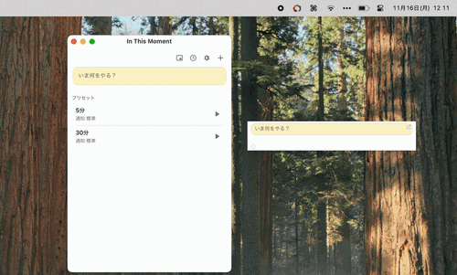

<h1 align="center">In This Moment</h1>

 

## 概要

目の前の数分から人生まで、あらゆる時間の残りを常時フローティングのブロックメーターで見せ続ける付箋タイマー。

付箋に「いま何をやるか」を書き、30分・5分などのプリセットや「終了日時を決めて始める」1回きりのタイマーで、残り時間をブロックのメーターで表示・通知する。メーターのメモリ数はタイマーごとに 2〜60 で設定できる。1日・1年・人生のような長い期間は名前付きの期間タイマーで持つ。

Mac はメニューバー常駐＋常に前面のフローティング表示、Android は一覧画面＋予約通知。

最新版は [Releases](https://github.com/leofujiike/in-this-moment/releases/latest) からダウンロードできます（Mac・Apple Silicon）。

## インストール

### Mac（Apple Silicon）：ビルド済みアプリ

[Releases](https://github.com/leofujiike/in-this-moment/releases/latest) から `In-This-Moment-v*-macos-arm64.zip` をダウンロードして展開し、`In This Moment.app` を「アプリケーション」フォルダへ移動します。

Apple の公証を受けていないため、初回は「Apple は検証できませんでした」と表示されて開けません。次のどちらかで開けます。

- 一度開こうとしたあと、システム設定 → プライバシーとセキュリティ → 下部の「このまま開く」を押す
- ターミナルで `xattr -dr com.apple.quarantine "/Applications/In This Moment.app"` を実行する

### Mac：ソースからビルド

Intel Mac の場合や、自分でビルドしたい場合はこちら。必要なもの：Xcode Command Line Tools、Rust、Node.js

    git clone https://github.com/leofujiike/in-this-moment.git
    cd in-this-moment
    npm install
    npm run tauri build
    cp -R "src-tauri/target/release/bundle/macos/In This Moment.app" /Applications/

ビルドせずに試すだけなら `bash start.command` で起動できます（Command Line Tools と Rust が無ければ案内・インストールし、Node.js が無ければ入手先を表示します）。

### Android

下の「Android」の手順で APK を作り、端末にインストールします。

## 開発

### Mac
    npm install
    npm run tauri dev                      # 起動（メニューバーに常駐）
    BLOCK_TIMER_DEBUG=1 npm run tauri dev  # 動作確認用：開始したタイマーが1/60の長さ
    npm run tauri build                    # src-tauri/target/release/bundle/macos/In This Moment.app

### Android（Android Studio・SDK・NDK と環境変数が必要）
    npm run tauri android init
    # src-tauri/gen/android/app/src/main/AndroidManifest.xml の <application> より前に追記：
    #   <uses-permission android:name="android.permission.SCHEDULE_EXACT_ALARM" />
    npm run tauri android dev                       # USB接続した実機で起動
    npm run tauri android build -- --apk --debug    # インストール用APK

### テスト
    cd src-tauri && cargo test

## UI の回帰テスト

リポジトリ直下で `python3 -m http.server 8765 --bind 127.0.0.1` を実行し、[UIテスト](http://127.0.0.1:8765/tests/ui.html) を開きます。バックエンドと保存先を模擬し、実データを変更せずに Mac・Android 表示とフローティングを検証します。

2026-11-10 の確認結果：Rust 36テスト、UI 57項目が成功。Mac の隔離したテストアプリで、自動色、完了表示、固定ボタン、再開始、停止、削除、高さ固定オン／オフの伸縮を確認しました。Android 実機、通知バナーの折り返し、複数モニターでの画面端補正は未確認です。

## ライセンス

[MIT License](./LICENSE)
